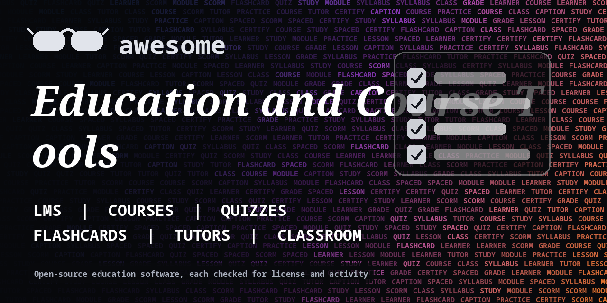

<h1 align="center">Awesome Education and Course Tools</h1>

> Open-source learning platforms, course builders, flashcards, quiz tools, classroom software and AI tutors. Every entry shows its license.

**Rules of this list:** every repo exists, is public, is not archived, states a license and has had a commit in the last year. One plain sentence each. Star counts and claims are the authors' own, we did not test every tool. Checked 2026-10-18. See [CONTRIBUTING.md](CONTRIBUTING.md).

## Contents

- [Learning management systems](#learning-management-systems)
- [Course authoring and interactive content](#course-authoring-and-interactive-content)
- [Flashcards and spaced repetition](#flashcards-and-spaced-repetition)
- [Quizzes and assessment](#quizzes-and-assessment)
- [Classroom and school tools](#classroom-and-school-tools)
- [AI tutors and study helpers](#ai-tutors-and-study-helpers)
- [Learn to code](#learn-to-code)
- [Lecture video and captions](#lecture-video-and-captions)
- [How to choose](#how-to-choose)
- [Contributing](#contributing)

## Learning management systems

Host courses and track learners.

- [chamilo/chamilo-lms](https://github.com/chamilo/chamilo-lms)  - Open-source learning management system. _(GPL-3.0)_
- [frappe/lms](https://github.com/frappe/lms)  - Easy to use, open-source learning management system. _(AGPL-3.0)_
- [instructure/canvas-lms](https://github.com/instructure/canvas-lms)  - Open-source learning management system from Instructure. _(AGPL-3.0)_
- [moodle/moodle](https://github.com/moodle/moodle)  - Open-source learning management system used worldwide. _(GPL-3.0)_
- [openedx/openedx-platform](https://github.com/openedx/openedx-platform)  - Open edX learning platform for online courses. _(AGPL-3.0)_

## Course authoring and interactive content

Make lessons, slides and exercises.

- [h5p/h5p-php-library](https://github.com/h5p/h5p-php-library)  - Library for creating and sharing interactive HTML5 content. _(GPL-3.0)_
- [hakimel/reveal.js](https://github.com/hakimel/reveal.js)  - HTML presentation framework for slides and lessons. _(MIT)_
- [jupyter-book/jupyter-book](https://github.com/jupyter-book/jupyter-book)  - Build books and documents from computational content. _(BSD-3-Clause)_
- [jupyter/notebook](https://github.com/jupyter/notebook)  - Interactive notebooks for code, text and results. _(BSD-3-Clause)_
- [marp-team/marp](https://github.com/marp-team/marp)  - Markdown presentation ecosystem. _(MIT)_
- [quarto-dev/quarto-cli](https://github.com/quarto-dev/quarto-cli)  - Scientific and technical publishing system. _(check repo)_
- [slidevjs/slidev](https://github.com/slidevjs/slidev)  - Presentation slides for developers, written in Markdown. _(MIT)_

## Flashcards and spaced repetition

Remember what you learn.

- [ankidroid/Anki-Android](https://github.com/ankidroid/Anki-Android)  - Anki flashcards on Android. _(GPL-3.0)_
- [ankitects/anki](https://github.com/ankitects/anki)  - Powerful, intelligent flashcards. _(check repo)_
- [mnemosyne-proj/mnemosyne](https://github.com/mnemosyne-proj/mnemosyne)  - Spaced repetition flashcard program. _(check repo)_
- [open-spaced-repetition/free-spaced-repetition-scheduler](https://github.com/open-spaced-repetition/free-spaced-repetition-scheduler)  - Free spaced repetition scheduler algorithm. _(MIT)_
- [open-spaced-repetition/fsrs4anki](https://github.com/open-spaced-repetition/fsrs4anki)  - Spaced repetition algorithm for Anki. _(MIT)_

## Quizzes and assessment

Test and grade.

- [formbricks/formbricks](https://github.com/formbricks/formbricks)  - Open-source survey and experience management platform. _(check repo)_
- [heyform/heyform](https://github.com/heyform/heyform)  - Open-source form builder for surveys and quizzes. _(AGPL-3.0)_
- [LimeSurvey/LimeSurvey](https://github.com/LimeSurvey/LimeSurvey)  - Open-source survey tool. _(check repo)_

## Classroom and school tools

Run classes and communicate.

- [bigbluebutton/bigbluebutton](https://github.com/bigbluebutton/bigbluebutton)  - Open-source web conferencing for online learning. _(LGPL-3.0)_
- [frappe/education](https://github.com/frappe/education)  - Education module for ERPNext to manage schools. _(check repo)_
- [jitsi/jitsi-meet](https://github.com/jitsi/jitsi-meet)  - Secure, simple and scalable video conferences. _(Apache-2.0)_
- [nextcloud/server](https://github.com/nextcloud/server)  - Self-hosted cloud for files, calendar and docs. _(AGPL-3.0)_
- [oppia/oppia](https://github.com/oppia/oppia)  - Free interactive lessons for learning. _(Apache-2.0)_

## AI tutors and study helpers

Always check answers against a trusted source.

- [gradio-app/gradio](https://github.com/gradio-app/gradio)  - Build and share machine learning demos in Python. _(Apache-2.0)_
- [Khan/perseus](https://github.com/Khan/perseus)  - Khan Academy's exercise and content renderer. _(MIT)_
- [khoj-ai/khoj](https://github.com/khoj-ai/khoj)  - Self-hostable AI second brain that searches your notes. _(AGPL-3.0)_
- [Mintplex-Labs/anything-llm](https://github.com/Mintplex-Labs/anything-llm)  - All-in-one app to chat with documents using any model. _(MIT)_
- [open-webui/open-webui](https://github.com/open-webui/open-webui)  - Self-hosted web interface for local and hosted language models. _(check repo)_
- [streamlit/streamlit](https://github.com/streamlit/streamlit)  - Turn Python scripts into shareable web apps. _(Apache-2.0)_

## Learn to code

Interactive coding practice.

- [exercism/website](https://github.com/exercism/website)  - Website for Exercism, free coding practice in many languages. _(AGPL-3.0)_
- [freeCodeCamp/freeCodeCamp](https://github.com/freeCodeCamp/freeCodeCamp)  - Free coding curriculum and platform. _(BSD-3-Clause)_
- [leachim6/hello-world](https://github.com/leachim6/hello-world)  - Hello World in many programming languages. _(MIT)_
- [microsoft/generative-ai-for-beginners](https://github.com/microsoft/generative-ai-for-beginners)  - 21 lessons on building generative AI applications. _(MIT)_
- [microsoft/Web-Dev-For-Beginners](https://github.com/microsoft/Web-Dev-For-Beginners)  - 24 lessons to learn web development. _(MIT)_
- [TheOdinProject/curriculum](https://github.com/TheOdinProject/curriculum)  - Free coding curriculum from The Odin Project. _(check repo)_

## Lecture video and captions

Record and caption lessons.

- [obsproject/obs-studio](https://github.com/obsproject/obs-studio)  - Free software for video recording and live streaming. _(GPL-2.0)_
- [openai/whisper](https://github.com/openai/whisper)  - General-purpose speech recognition model for captions. _(MIT)_
- [OpenShot/openshot-qt](https://github.com/OpenShot/openshot-qt)  - Easy video editor, useful for lecture videos. _(check repo)_
- [SubtitleEdit/subtitleedit](https://github.com/SubtitleEdit/subtitleedit)  - Free editor for video subtitles. _(MIT)_

## How to choose

- **Check accessibility.** Captions and keyboard use matter for learners.
- **Protect student data.** Check FERPA, GDPR and local rules.
- **Check the license** if you sell courses.
- **Test with a small group** before a full class.

## Contributing

See [CONTRIBUTING.md](CONTRIBUTING.md). One entry per pull request, plain words, real sources only.

## About

Maintained by [@devanasolver](https://github.com/devanasolver). Listings follow the rules in CONTRIBUTING.

## Sponsor me

If this list is useful, [buy me a coffee](https://buymeacoffee.com/isaac49).
